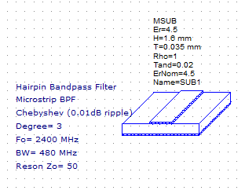
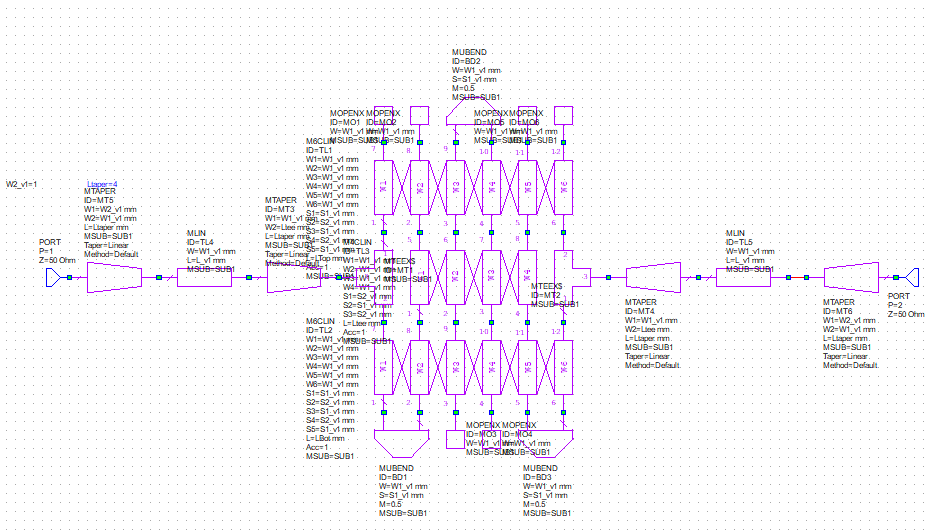
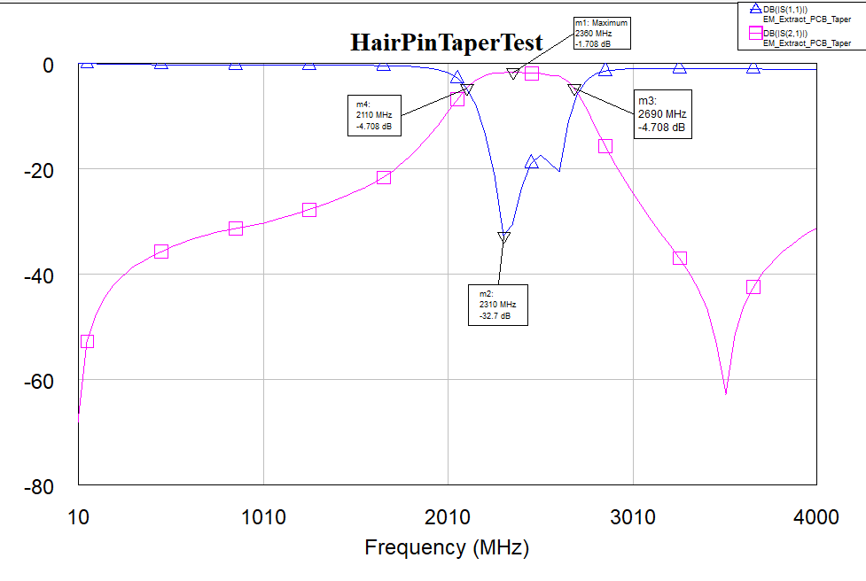
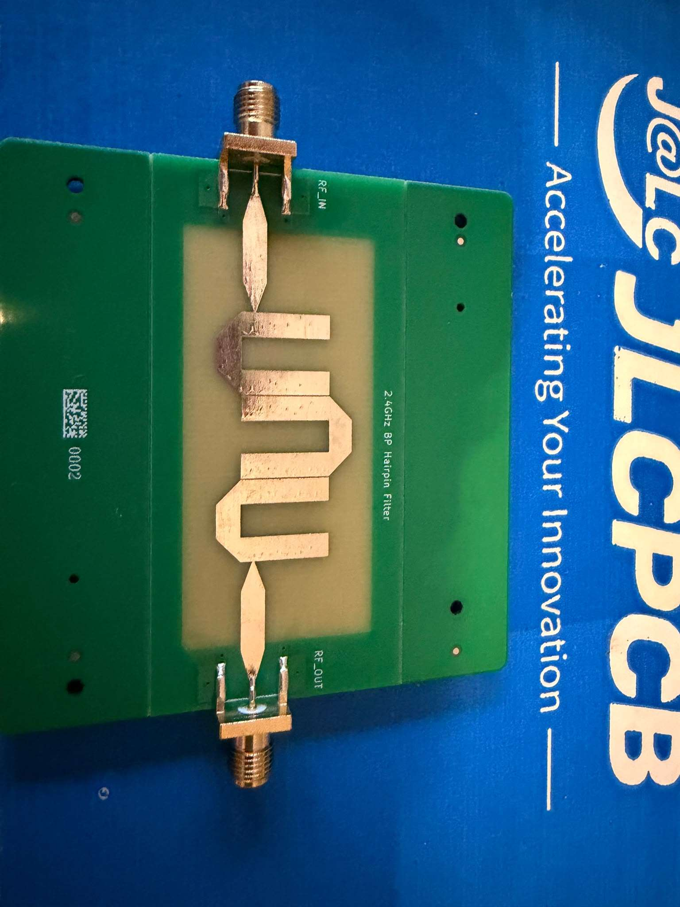
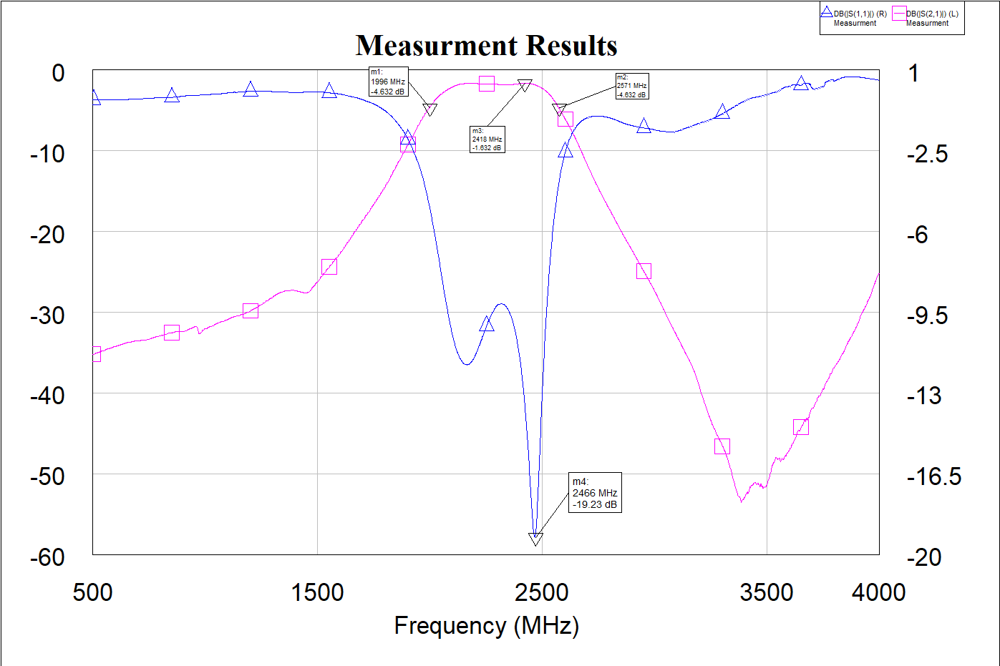
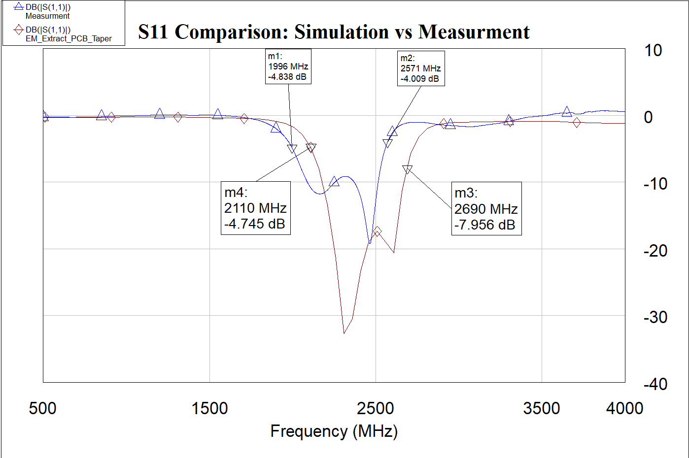
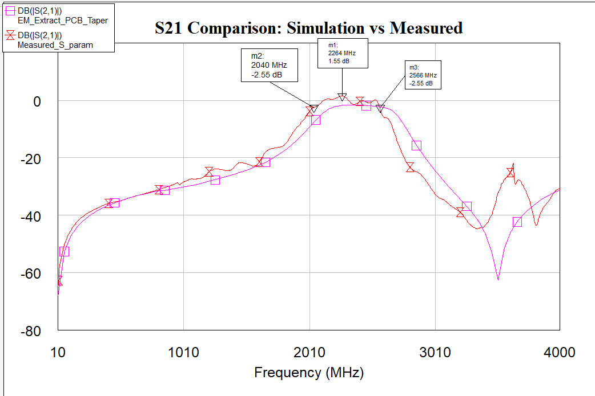

# 2.4 GHz Microstrip Bandpass Filter Design Project

Design, simulation, and fabrication of a microstrip hairpin bandpass filter.

Design and simulation were done with AWR Microwave Office (Axiem 2.5D MoM).
Fabrication was done at JLCPCB.

## Specification and Design Goals

| Parameter | Specification Goal |
|---|---|
| Center frequency fc | 2.4 GHz |
| 3 dB bandwidth | Wideband, 480 MHz+ |
| S11 passband | < −15 dB |
| S21 passband | > −3 dB |

### Stackup

  

## Design and Simulation

The iFilter wizard in AWR MWO provided a good starting geometry for reaching the
desired specifications. For optimization, the 2.5D Axiem solver was chosen to
simulate a more realistic behavior of the microstrip lines. Since the filter needs
connectors for measurement, the required tapers were also included in the simulation.

| Key Characteristic | Simulation |
|---|---|
| Center frequency fc | 2.4 GHz |
| 3 dB bandwidth | 580 MHz (2110–2690 MHz) |
| S11 passband | < −15 dB (2220–2640 MHz) |
| S21 passband | > −4.7 dB, peak at −1.7 dB |

  

  

  

## Measurement

Measurements were performed with a PicoVNA.

  

| Key Characteristic | Measurement |
|---|---|
| Center frequency fc | 2.2835 GHz |
| 3 dB bandwidth | 575 MHz |
| S11 passband | < −10 dB ( 1987 MHz - 2515 MHz)|
| S21 passband | > −3 dB (2050 MHz - 2520 MHz), peak of -1.632 dB |

  

  

  

## Differences Between Simulation and Measurement

As expected, the measurements differ from the simulation, but the results were surprisingly good. A shift in center frequency and worse S11 can be observed.

The shift from 2.4 GHz to 2.2835 GHz indicates that the actual FR4 permittivity was higher than the simulated value (higher εr → shorter wavelength → lower resonant frequency). FR4 is inexpensive, but its dielectric constant varies significantly between batches and even across a single PCB.

A measured peak S21 of −1.632 dB was reached, matching the simulated −1.7 dB remarkably well and validating the assumed loss tangent. Furthermore, the measured 3 dB bandwidth is only 5 MHz smaller than the simulation (575 MHz vs. 580 MHz), which is a great result.

In the simulation, a deep dip of ~ -63 dB can be observed at ~ 3.5 GHz. A similar dip of this depth cannot be observed in the measurements. Reasons for this could be:
1. Resonance effects from the SMA connector (rated for DC-3GHz).
2. The measurement noise floor masking the real dip.
3. Non-ideal calibration (An indication for this is a positive S11 measurement starting from ~ 3.5 GHz).

The return loss (S11) is worse than in simulation, and the response appears inverted in the measurements even though the filter is geometrically symmetrical. This is very likely due to the fact that the SMA connectors were not modeled in the simulation. It could also indicate that the taper to the connector is not as ideal as simulated, resulting in a worse impedence match at the desired frequencies.

## Conclusion

This project was a very good learning experience and yielded good results for a
first attempt. Even though the simulation used only 2.5D MoM, the resulting
S11/S21 parameters are good enough for use in a real design,
with S21 as low as −1.6 dB. Manufacturing effects such as the shifted
center frequency became visible. 

For future iterations, a more suitable substrate should be chosen, and a small
test strip for measuring the relative permittivity should be included on the PCB.
